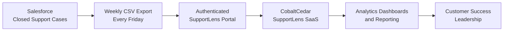

# Business Process and Data Flow

## 1. Purpose

This document describes the business process, information flow, system boundaries, and data exposure associated with Avenloft's use of CobaltCedar SupportLens.

The objective is to understand the vendor relationship from a data and process perspective before assessing individual cybersecurity risks.

**Case ID:** GRC-TPRM-003  
**Organization:** Avenloft Systems Group, Inc. (Fictional)  
**Vendor:** CobaltCedar Analytics, Inc. (Fictional)  
**Service:** CobaltCedar SupportLens

## 2. Business Process Overview

Avenloft uses SupportLens to analyze closed customer-support cases and generate reporting for Customer Success leadership.

The business process supports:

- Product-related support theme analysis.
- Customer response trend analysis.
- Escalation pattern reporting.
- Account-level support volume analysis.
- Customer Success planning and reporting.

SupportLens is a reporting and analytics service. It is not required to operate Avenloft Relay or maintain frontline customer support.

## 3. Current Business Process

The current process follows these steps:

| Step | Process activity | Responsible party |
|---|---|---|
| 1 | Customer support cases are maintained in Salesforce. | Avenloft |
| 2 | Customer Success Operations exports the previous week's closed support cases every Friday. | Avenloft |
| 3 | The exported records are saved in CSV format. | Avenloft |
| 4 | An authorized user uploads the CSV through the authenticated SupportLens web portal. | Avenloft |
| 5 | SupportLens processes the uploaded support-case data. | CobaltCedar |
| 6 | SupportLens generates analytics dashboards and account-level reporting. | CobaltCedar |
| 7 | Customer Success leadership uses the reports for trend analysis and planning. | Avenloft |

The service does not have a direct Salesforce integration.

The vendor has no credentials into Avenloft systems.

## 4. Data Flow Diagram

**Flow interpretation:**

1. Salesforce is the source of the closed support-case records.
2. Avenloft exports the previous week's records into a CSV file.
3. An authorized Avenloft user uploads the file through the vendor's authenticated web portal.
4. CobaltCedar processes the uploaded information within SupportLens.
5. The service generates analytics dashboards and reporting.
6. Avenloft Customer Success leadership uses the resulting information.

## 5. Information Included in the Export

### 5.1 Included information

| Data element | Description | Assessment consideration |
|---|---|---|
| Customer company name | Customer organization identifier | Customer business information |
| Business contact name | Contact associated with a support case | Personal information |
| Business contact email | Business contact email address | Personal information |
| Ticket subject | Support issue description | May reveal operational details |
| Ticket free-text body | Customer-provided issue and troubleshooting details | May contain sensitive technical information |
| Severity | Support-case severity | Operational information |
| Product area | Product associated with the case | Business and technical information |
| Timestamps | Case-related dates and times | Operational information |
| Case owner | Assigned support-case owner | Workforce-related information |
| Resolution code | Recorded case resolution | Operational information |

### 5.2 Excluded by current process

| Data element | Current treatment |
|---|---|
| Ticket attachments | Excluded |
| Authentication secrets | Excluded by design |
| Payment-card data | Excluded by design |
| Avenloft source code | Not included |
| Direct production database records | Not included |

**Important limitation:**

The exclusion of attachments and authentication secrets does not guarantee that free-text ticket bodies contain no sensitive technical information.

Customers may paste log excerpts, hostnames, identifiers, or troubleshooting details into ticket text.

This creates a data-minimization and information-handling concern that should be considered during the vendor risk assessment.

## 6. System and Trust Boundaries

| Boundary | Description | Risk consideration |
|---|---|---|
| Avenloft internal environment | Salesforce contains the original closed support cases. | Source data may contain customer and technical information. |
| Export boundary | Avenloft creates a weekly CSV export. | Data leaves the original Salesforce environment. |
| Transfer boundary | An authorized user uploads the CSV through the authenticated vendor portal. | Upload permissions and user authentication matter. |
| Vendor environment | SupportLens processes and stores the uploaded data. | Avenloft relies on vendor security and tenant-isolation controls. |
| Reporting boundary | Vendor-generated dashboards are used by Customer Success leadership. | Access to uploaded data and generated reports must be appropriately restricted. |

The vendor's service is described as multi-tenant SaaS hosted in AWS U.S. regions.

The supplied vendor overview describes logical tenant isolation, but the assessment must distinguish the vendor's architecture statements from independently tested evidence.

## 7. Access and Integration Assessment

| Assessment question | Current case fact |
|---|---|
| Does the vendor have direct Salesforce access? | No |
| Does the vendor have Avenloft production credentials? | No |
| Is there a direct Salesforce integration? | No |
| How is data transferred? | Weekly manual CSV export and upload |
| Is the upload portal authenticated? | Yes |
| How many Avenloft users use the service? | 8 |
| How many accounts have TOTP MFA enabled? | 5 of 8 |
| How many accounts can export vendor analytics results? | 4 of 8 |
| Can all eight accounts view uploaded support data? | Yes |

The absence of direct system integration reduces the vendor's direct access to Avenloft's internal environment.

However, the vendor still receives and processes Avenloft customer-support information. The data exposure therefore remains relevant even without direct system access.

## 8. Key Data Exposure Points

| ID | Exposure point | Potential concern |
|---|---|---|
| DF-01 | Weekly Salesforce CSV export | Excessive or unnecessary records may be included. |
| DF-02 | CSV file handling before upload | The exported file may be exposed during handling or storage. |
| DF-03 | Authenticated portal access | Compromised or insufficiently protected accounts may expose uploaded data. |
| DF-04 | Vendor-side data processing | Weaknesses in vendor application security or tenant isolation may expose customer information. |
| DF-05 | Vendor data retention | Uploaded support records remain in the service for the configured retention period. |
| DF-06 | User access to uploaded data | All eight Avenloft users can view uploaded support data. |
| DF-07 | Analytics export permissions | Four Avenloft users can export vendor analytics results. |
| DF-08 | Free-text support content | Customer-provided logs or technical identifiers may be included. |

These are exposure points for further assessment, not confirmed security incidents.

## 9. Business Dependency Assessment

SupportLens provides analytical and reporting value to Customer Success.

However:

- Avenloft Relay can continue operating without SupportLens.
- Frontline customer support can continue without the service.
- Salesforce reporting provides an alternative reporting method.
- Replacing the existing reporting workflow would create additional manual work.

**Preliminary assessment:**

The service is useful but not operationally critical.

Its business dependency should therefore be evaluated separately from its information-security exposure.

A lower operational dependency does not automatically mean that the vendor presents low data-security risk.

## 10. Preliminary Risk Considerations

The data flow identifies several areas requiring further due diligence:

1. **Data minimization:** Determine whether every exported field is necessary for the reporting purpose.
2. **Free-text exposure:** Understand how customer-provided technical details are identified and handled.
3. **Authentication:** Evaluate the implications of TOTP MFA being enabled on only five of eight Avenloft accounts.
4. **Access governance:** Assess whether all eight users need access to uploaded support data.
5. **Vendor isolation:** Review the evidence supporting multi-tenant logical isolation.
6. **Data retention:** Evaluate the 180-day default retention period.
7. **Data deletion:** Review deletion timelines and backup lifecycle requirements.
8. **Vendor monitoring:** Determine whether available customer activity history is sufficient for oversight.

These considerations will be evaluated against the vendor evidence and risk scenarios in subsequent documents.

## 11. Conclusion

CobaltCedar SupportLens receives Avenloft customer-support information through a weekly manual CSV export and authenticated portal upload.

The vendor has no direct Salesforce integration or credentials into Avenloft systems. Nevertheless, the uploaded information includes customer business contact details and free-text support content that may contain sensitive technical information.

The relationship therefore creates a third-party information exposure that must be assessed independently of annual contract value and direct system access.

The next assessment stage will evaluate the vendor's supplied security evidence, questionnaire responses, independent assurance summaries, penetration-test findings, incident history, and contractual terms.

## 12. Source

Primary source: Avenloft Systems Group, GRC-TPRM-003, Third-Party Vendor Risk Assessment Case File, October 12, 2026.

Relevant sections:
- Why This Review Exists — Page 3
- Third-Party Classification Factors — Page 4
- Vendor and Service Profile — Page 5
- Current Data Flow and Export Fields — Page 5
- Vendor Security Overview and Avenloft Account State — Page 6
